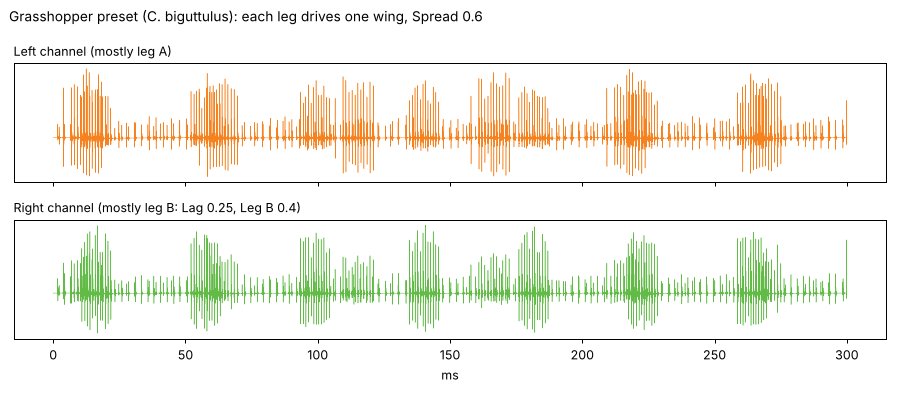
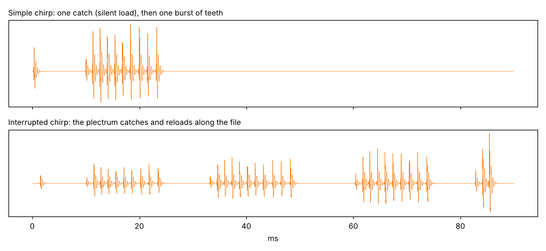
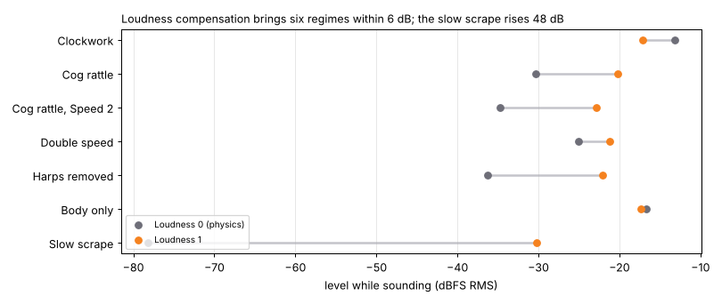
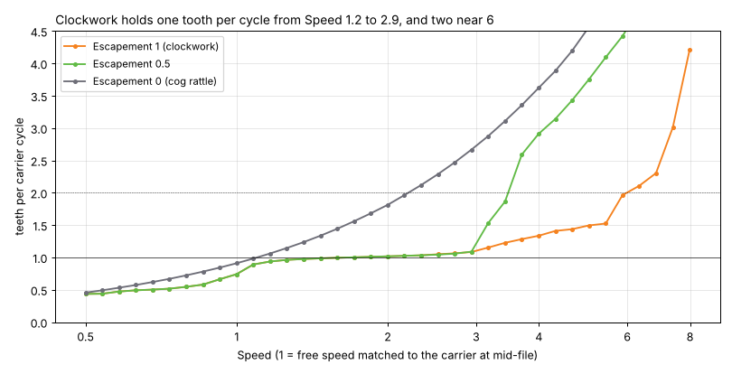
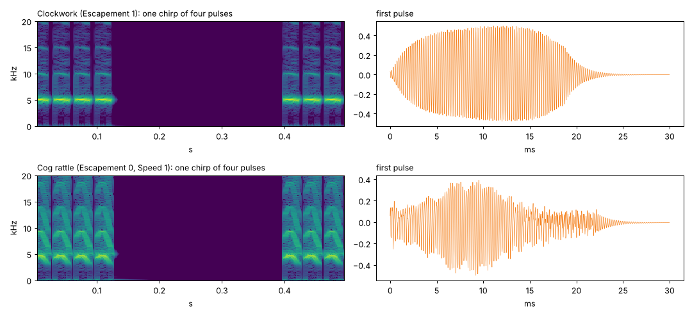

# stridulation · tests

Quick results per batch: tests, experiments and pictures. Pictures live in `docs/tests/`. Run the
tests with `node tests/engine-test.js`. Test numbers refer to `design.md` §11.

**Now: 79 engine tests passing** (about 45 s). Benchmark: `node tools/perf.js`.

## Batch 06 · song, limbs, Scrape

The voice is rebuilt around **limbs**: each limb has its own file contact, stroke and pulse
stream, and the contact maths is unchanged. One limb drives both wings. Two limbs
(grasshoppers) drive one wing each, and each escapement reads its own wing.

Built:
- **Song engine:** chirps of strokes, trills, Phrase and Pause, Rubato (seeded; ±2.5% on chirps,
  ±1% on strokes at 1), and Sync (strokes per beat and chirp lengths snap to note values, chirps
  fall on the beat grid; Temperature is then ignored). `setTempo` and `setPosition` for the host.
- **Arc growth:** in a chirp, the first stroke uses 40% of the arc at Arc growth 1, growing to
  the whole arc by the last. Shorter strokes start further along the file and push 30% less
  (Bennet-Clark & Bailey 2002).
- **Open:** each stroke opens back along the file before it closes. The opening stroke is a cog
  rattle at Open's level, pulled at 0.4 of the force (Elsner: upstrokes ~3× slower). Open 0
  skips it entirely, so crickets keep their timing.
- **Shape:** Smooth, Steps (three jerks per stroke) or Vibrate (twelve shivers per stroke), on
  the muscle force.
- **Two limbs:** Lag delays leg B by a share of the stroke period. Leg B's pattern is set by a
  new knob, **Leg B** (0–1): up to 35% less force and a pause of up to 40% of the stroke early on,
  after Elsner's pattern II. **Swap** is the chance per chirp that the legs trade patterns.
- **Scrape:** each note is one stroke. If the mod wheel moves under a held note, the plectrum
  follows the wheel along the arc; going back strikes at Open's level (silent at 0), like a guiro.
- **Controllers:** mod wheel (Song) speeds the stroke up to ×2.83, aftertouch adds up to ×2 force.
- **Swell:** attack and release on the muscle force. Both default to 1 ms, which acts at once:
  full force from the first sample, and the song stops at note-off. A 5 ms attack (the design's
  default) slowed the first stroke enough to break the lock tests. Longer settings fade the
  insect in and out; after note-off the song goes on while the swell fades, each new stroke at
  the swell of its start.
- **Mono glide and legato:** a note played over a held one glides (Glide time, log pitch) and
  the song goes on; releasing it glides back to the note still held.
- **Four LFOs:** as in Dolphin. They can move every continuous knob except those that rebuild
  the file. New knobs: **Leg B** and **Pause**.

Tests:

- Note-off mid-stroke: that stroke finishes (94 teeth), no other starts. ✓
- With the song engine, rubato and two limbs: identical output at buffer sizes 1, 77, 1000. ✓
- Arc growth 1: 34, 53, 73, 94 teeth through a chirp. ✓
- Rubato: stroke interval max/min 1.000 at 0, 1.218 at 1. ✓
- Phrase 0.5 s, pause 0.5 s: 24 strokes in 2.2 s, none in pauses. ✓
- Sync at 120 bpm: chirps on the 2/3-beat grid within 0.02 ms, with rubato at 0.5. ✓
- Open 0.5: an opening stroke (188 events) before the closing one; none at Open 0. ✓
- Two limbs: leg B starts 12.50 ms after A (Lag 0.25 × 50 ms). Leg B at 1 takes several times
  longer with its pause. Swap 0.5: the legs traded in 21 of 49 strokes. ✓
- Shape: impulse interval CV 0.12 Smooth, 1.13 Steps, 0.91 Vibrate. ✓
- Scrape: one stroke per note; the wheel drags the plectrum over 94 teeth (arc 0.8 × 120);
  dragging back is silent at Open 0 and sounds at Open 0.7. ✓
- Glide: 681.9 Hz after one Glide time from A4 to A5 (exactly 63% of the octave); legato doesn't
  restart the song. ✓
- A dormant LFO changes nothing; an LFO holding Speed sets the tooth rate exactly as the knob. ✓
- Mod wheel at 1: tooth rate ×2.82; aftertouch at 1: ×2.00. ✓
- Attack 0.3 s: first stroke 422 ms, later ones 23 ms. ✓

Cost (`tools/perf.js`): 8 voices trilling at high notes 32%; worst case (8 voices, two limbs,
opening strokes, body, second mode, four LFOs) 48%. Syrinx's worst case is 47% for 4 voices.

New presets: 23 *C. biguttulus* and 24 *O. viridulus* (two legs, Open, after Elsner's timings),
25 a vibrating leg played as a scrape.

**You:** listen to 23–25, and to the earlier presets, which now have Arc growth and Rubato.

## Batch 05 · spring and macros

Built: the Spring contact, Temperature, Size, Ultra and Time. Tune now runs ±48 semitones, so
ultrasonic carriers can be set before Ultra divides them. Spring defaults to Stiff (0), the
stiff contact of batches 02–04, unchanged below 0.02.

**Spring as built.** No paper gives equations for spring stridulation, so this is a
phenomenological model fitted to Lindeman & Yack (2019):
- a driver (the muscle or abdomen) moves on at a slow speed: Speed × carrier × slow(Spring),
  with slow running from 1 at Spring 0 to 0.5 at 0.8 and 0.02 at 1;
- the plectrum lodges on a tooth and stays there until the driver has stretched it by
  0.4 × (teeth per burst) spacings (× Height and the tooth's own height);
- released, it slips at Speed × carrier, slowing toward the driver. It strikes every tooth it
  crosses and lodges on the first tooth it meets below 0.75 of its starting speed. The slowing is
  set so a burst covers about 1 + 12.5 × Spring² teeth (9 at 0.8).

At small Spring the driver is as fast as the slip, so the plectrum never lodges and Spring
continues the stiff cog rattle. The escapement doesn't act on the spring contact, since katydids
and beetles have none.

Tests:

- 7 Bark beetle (*D. valens* settings): first catch loads 9.9 ms before sound (paper 8–12.5); a
  simple chirp is 9 pulses at 657/s over 12.2 ms (paper 9.1 pulses, ~695/s, 13.6 ms); a longer
  stroke catches 4 times (interrupted chirp). ✓
- Spring 0.03 continues the stiff cog rattle: tooth rate 0.996 → 0.983 × carrier. ✓
- 4 Escapement off: tooth rate from 15 to 32 °C ×1.530 (*Oecanthus*: 3.0 → 4.6 kHz, ×1.533). ✓
- 4 Escapement on: carrier from 20 to 30 °C +2.0% (Koch et al.: 0.7% per °C, so under 7%). ✓
- 4 Chirp rate follows (T − 4) / 21: 12 strokes at 15 °C, 21 at 25 °C in 2 s. ✓
- Size 2, Keytrack off: 2712 Hz (fit: 2681 Hz). Keytrack on: same pitch, pulse 1.79× longer
  (2^0.81 = 1.75). ✓
- Ultra ÷10 from 47 kHz: 4737 Hz. Time 1: pulses 9.8× longer; Time 0: 0.90× (real length); Time
  0.5: 2.9× (√10 = 3.2). ✓

New presets 15–22: mole cricket, tree cricket at 15 and 32 °C, pure-tone katydid
(*Tympanophora*), bark beetle simple and interrupted, ultrasonic katydid (*Arachnoscelis*, Ultra
÷10, Time 1), Jurassic katydid (*Archaboilus*). Grasshoppers wait for two limbs (batch 06).

Notes for the listening round:

- **Tree cricket wing.** Sismondo measured Q 25–35, but at that Q an off-tune drive rings the
  wing at its own pitch and fills the gaps between pulses. The presets use Ring 6, after Mhatre et
  al.'s broad-plate wing. At 15 °C it's still harmonic-rich rather than a pure tone.
- **Spring near 1** is steep: Arachnoscelis needs 0.999 to get its ~2 ms pulse period. A curve
  that spends more of the knob near the top could help. [Open]
- Cost: no change from batch 04 within the machine's noise (8 voices trilling high, 27–35%).

**You:** listen to 15–22.

## Batch 04 · full radiator, loudness, pitch lock

Built: two wings (Sismondo's frame and membrane each, one per side with Spread), Wings detune,
a stiffening frame (Nonlinear), Glide by plectrum position, a Second mode per wing, the Body,
loudness compensation and Pitch lock.

Findings while building:

- **Two detuned wings cancel unless joined.** At ±4% either side of the note, one wing answers in
  phase and the other nearly against it. Joining the membranes through the plectrum (strong
  while engaged, 0.6 × w²; light when free, 0.02 × w²) gives them one shared mode, as Bennet-Clark
  (2003) found. The detune then shows as beating in the free tail. With that coupling the lock
  range is back to Speed 1.5–2.9, and double speed is clean at 6.
- **Stiffening.** Sismondo's X⁵ blew up at the frame's real amplitude (|X| 1.8 locked, 5.4
  overdriven). He notes a cubic works as well, so the frame now has a cubic spring that saturates
  at +300% stiffness. Stable at every setting.
- **Test 5 (n:m locks) is not reproduced yet.** Driving a cog rattle at 3/4 or 4/5 of the wing,
  this frame (2.5 × carrier, Q 3) gives only tooth-rate harmonics. With the frame moved to
  1.25 × carrier, Q 8, stiffening does bring strong period doubling (peaks at 1.5× and 2.5× the
  tooth rate), one of Sismondo's behaviours. That frame breaks three of Koch's behaviours, even
  with Nonlinear at 0: Speed 6 gives 1.34 teeth per cycle instead of 2, 34% sharp, a stroke 1.32×
  faster instead of 2×; the wing crosses a gap at 0.67× its speed instead of faster; and free
  decay reads Q 46 at Ring 40. Kept as it is, behind the experimental **Frame** switch (Normal,
  Close), off by default. Two possible fixes are in `plan.md`. [Decided]
- **Second mode and Body** are two-pole resonators normalised to unit peak gain and fed like the
  wing, so their level holds across pitch. The Body's input is scaled by (carrier / 4.7 kHz)^0.6,
  since the tooth impulses grow as the carrier falls.
- **Pitch lock:** a keeper measures each release-to-release interval against the note (glided),
  then nudges the wing's tuning and the muscle's push together (±1200 cents, 0.08 per release).
- **Loudness compensation:** each voice learns its level while stroking (mean square, 40 ms of
  stroking time) and aims for 0.2 RMS. It is also capped so a voice's recent peak stays under 0.6,
  and any sample over 0.8 is pulled down at once, which matters for clicky sounds and a voice's
  first moments. A new voice starts from the last voice's gain. Velocity then sets the level
  explicitly.

Tests:

- Glide −10% and −20%: locked pitch falls 9.1% and 15.6% through the stroke. ✓
- Spread 1 puts the wings on different sides, Spread 0 is mono. ✓
- 20% detune: 7 bumps in the free-tail envelope; matched wings: none. ✓
- Second mode at 0 dB: +31 dB at 2.7 × carrier. ✓
- Body: +47 dB at 1 kHz and +29 dB at 10 kHz (Ring 0.7, Body tone 1 kHz). ✓
- Pitch lock off by default. Clockwork at Speed 2.5: 44.6 → −1.7 cents; at 2.8: 80.3 → −3.0. Cog
  rattle at Speed 1.3: 331 → −18.5 cents (the rest is Curve's swell within the stroke). ✓
- Loudness: six regimes spread 23.1 dB off, 5.7 dB on; peak −5.6 dBFS. ✓
- Frame Normal by default. Frame Close with Nonlinear 1, cog rattle at 0.8 of the wing: half-rate
  partials 6.7 dB below the tooth-rate ones (Normal: 40.1 dB below). ✓
- Batch 02's contact tests run with Wings, Glide, Nonlinear and Second off, to test the contact
  alone; the defaults still lock (0.995 of the carrier at Speed 2).

Cost now (`tools/perf.js`): 1 voice 3–6%, 8 voices trilling at high notes 26.7%. That matches the
batch 03 projection before the second limb.

New presets: 11 leafcutter ant (body only), 12 field cricket with wide wings and glide, 13 a
clockwork pushed sharp with Pitch lock on, 14 Frame Close sub-octave (experimental).

**You:** listen to 01–14.

## Batch 03 · cost

- `tools/perf.js` (one 2.1 GHz Xeon core, 48 kHz):

  | Scenario | CPU |
  |---|---|
  | Silent | 0.3% |
  | 1 voice, defaults (chirps) | 2–3% |
  | 1 voice, clockwork trill, 5 kHz | 2.6% |
  | 1 voice, clockwork trill, 15 kHz | 2.5% |
  | 1 voice, cog rattle, Speed 8, 15 kHz | 3.0% |
  | 4 voices, clockwork trill | 6.3% |
  | 8 voices, defaults | 11.1% |
  | 8 voices, clockwork trill, high notes | 12.5% |

- Where it goes: the wing integration is about a quarter of a voice (8 voices: 13.1% with it,
  9.5% without). The rest is the contact, the song clock and the 4× decimation.
- Projection for the full voice: three times the wing work (two nonlinear wings and a body) puts
  8 voices at 21%; a second limb adds roughly another contact, so about 27% at the worst case.
  Syrinx needs 40% for 4 voices.
- RK4 step rule: one sub-step per 0.5 rad of the frame's frequency per internal sample. Free-ring
  pitch error under 0.1 cent from 2 to 30 kHz at this rule, the same as at 0.25. Kept.
- The stroke uses implicit Euler, stable at any step: no sub-steps. The soft plectrum of Spring
  (batch 05) gets its own step rule there.
- Decided: Poly has 8 voices.

## Batch 02 · contact and one wing

Experiments before building (a scratch prototype of stroke, plectrum and wing):

- A release law based on force alone (hold more while the file is low) never locked: the plectrum
  met the next tooth while the file was still high and let go again, so the rate ran free.
- What locks is Bennet-Clark & Bailey's phase picture. Release near the top of the file's swing,
  only after the file has swung back down since the last release (re-arming). A plectrum that
  meets a tooth within half a cycle of a release, while the file is still high, slides over it.
  That slide is what gives Koch's double speed.
- The wing must be light (inertia about 0.1 carrier cycle), or it overshoots into a tooth and
  forces releases at any phase.
- The escapement reads the file's vibration, not its steady deflection under load (high-passed at
  carrier / 4). Without that, a heavily damped wing deadlocked against one tooth.
- Its authority scales with the wing's Q (half at Q 5): a wing that doesn't ring can't regulate,
  so Ring near 0.7 behaves like Koch's crickets with the harps removed.
- The phase it reads is advanced by one internal sample. Without that, the lock pitch drifted
  with the carrier, from 1.5% sharp at 300 Hz to 1.3% flat at 15 kHz.

The sweep (4.7 kHz carrier, one 96-tooth stroke):

- **Escapement 1:** one tooth per cycle from Speed 1.2 to 2.9, pitch −4% to +7.5%. Below that it
  locks at one tooth every two cycles, still on the carrier. Between 3.2 and 5.5 it slips: the
  tooth rate climbs and the pitch follows it. Near 6 it locks again at two teeth per cycle.
- **Escapement 0:** the tooth rate follows Speed.
- Koch et al. saw only normal and exactly double speed, never in between. The slipping band
  between them is the model's; worth hearing in the listening round.

Tests:

- 1 Clockwork, one tooth per cycle, at 300 Hz, 1, 4.7, 10 and 15 kHz: 1.004–1.041. ✓
- 1 Tooth rate = carrier within 2%: worst +1.7% at 300 Hz, +0.7% at 4.7 kHz, −0.2% at 15 kHz. ✓
- 1 Speed ∝ spacing through the origin with slope = carrier (Koch et al., Fig. 5): r² 0.993–0.999,
  slope within 2.6%. ✓
- 2 Speed 6: 1.98 teeth per cycle, stroke 1.95× faster, pitch +9% (Speed 2: 1.02). ✓
- 2 Cog rattle: tooth rate 0.97× carrier at Speed 1, 1.45× at Speed 1.5. ✓
- 3 Gaps: the wing crosses a missing tooth faster than its normal speed (slowest 1.23×), takes one
  half-cycle catch to find the phase, then runs one tooth per cycle again (7 of 7). ✓
- 3 Harps removed (Ring 0.7): stroke 1.78× faster. The factor is the free speed (Speed 2 here);
  Koch's "up to 3×" corresponds to a cricket pushing at Speed 3. ✓
- 6 Free decay Q: 10.1, 25.1, 40.1 for Ring 10, 25, 40. ✓
- 8 Same output at buffer sizes 1, 64, 1000; same seed same output; another seed another file. ✓
- Presets finite and not silent; parameter extremes finite at notes 0 and 127; chirp timing. ✓

Notes for the listening round:

- **Pitch rises with drive** when locked: +0.6% at Speed 2, +2.7% at 2.5, +7.5% at 2.9.
  Physically right: an escapement pulls its regulator, and Sismondo puts the limit near 15%.
  Decided: a pitch-locked mode, off by default (batch 04).
- **Levels follow the physics.** A locked clockwork is about 18 dB louder than a cog rattle at the
  same carrier, and a slow scrape (Speed 0.03) sits near −52 dBFS. Decided: loudness compensation
  (batch 04).
- Speed now runs 0.01–8 (was 0.25–4 in the design) and defaults to 2, the middle of the lock.

Renders: `node tools/render-presets.js` writes the ten presets to `renders/`, each normalised to
−6 dBFS. It prints each engine's own level.

**You:** listen to 01–03 (Escapement 1, 0.6, 0.3), 04–05 (cog rattle), 06 (double speed),
07 (damaged file), 08 (harps removed), 09 (separate ticks), 10 (*Teleogryllus*).
